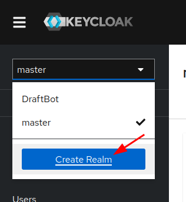
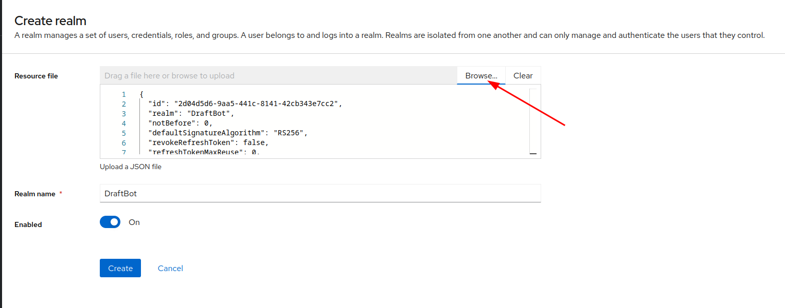
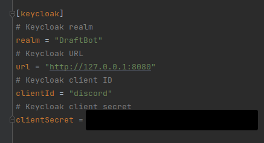

# Keycloak

Keycloak is the project used to authenticate users on Crownicles. It stores its data in the MariaDB database started next to it.

## Start with docker

Before starting, **make sure** you are in the folder `src/keycloak/`.  

You can start Keycloak with docker using the following command:

```bash
docker-compose up -d
```

You can find the docker-compose file here:
[docker-compose.yml](./docker-compose.yml) 

Keycloak waits for MariaDB to be healthy, then creates its tables on its first startup.

## Allow emojis in Keycloak data

Keycloak declares some columns as `NVARCHAR`, which MariaDB always creates in `utf8mb3`: a Discord name containing an emoji is then rejected. Once Keycloak has started for the first time, and again after each Keycloak upgrade, convert these columns to `utf8mb4`:

```bash
docker exec -i mariadb_keycloak mariadb -uroot -proot < convert-to-utf8mb4.sql
```

The script only touches the remaining `utf8mb3` columns, so it can be run again safely.

## Migrate an existing setup from H2

Keycloak used to fall back on its embedded H2 database, stored in `PROJECT_ROOT/keycloak/data/h2`, because the docker-compose file used outdated variable names. To keep your users and realms, export them from H2 with Keycloak stopped, then import them into MariaDB:

```bash
docker-compose stop keycloak
docker run --rm -v PROJECT_ROOT/keycloak/data:/opt/keycloak/data -e KC_DB=dev-file \
  quay.io/keycloak/keycloak:26.8 export --dir /opt/keycloak/data/export --users different_files
docker-compose up -d mariadb_keycloak
docker run --rm --network keycloak_default -v PROJECT_ROOT/keycloak/data:/opt/keycloak/data \
  -e KC_DB=mariadb -e KC_DB_URL=jdbc:mariadb://mariadb_keycloak:3306/keycloak -e KC_DB_USERNAME=keycloak -e KC_DB_PASSWORD=password \
  quay.io/keycloak/keycloak:26.8 import --dir /opt/keycloak/data/export --override true
docker-compose up -d keycloak
```

If the import fails on an emoji, run the `utf8mb4` conversion above, then run the import again. `keycloak_default` is the network created by docker compose for this folder: check its name with `docker network ls`.

If you do not need your local users, simply start fresh and import the realm as described below.

## Configuring a realm

Visit http://127.0.0.1:8080/admin/master/console/ (Default credentials are admin/admin)

First click on the create realm button:



Import the already configured realm: [realm.json](realm.json):



Configure your Discord config.toml:

You will need to regenerate a client secret here on keycloak:

Manage -> Clients -> discord -> Credentials -> Client Secret -> Regenerate

